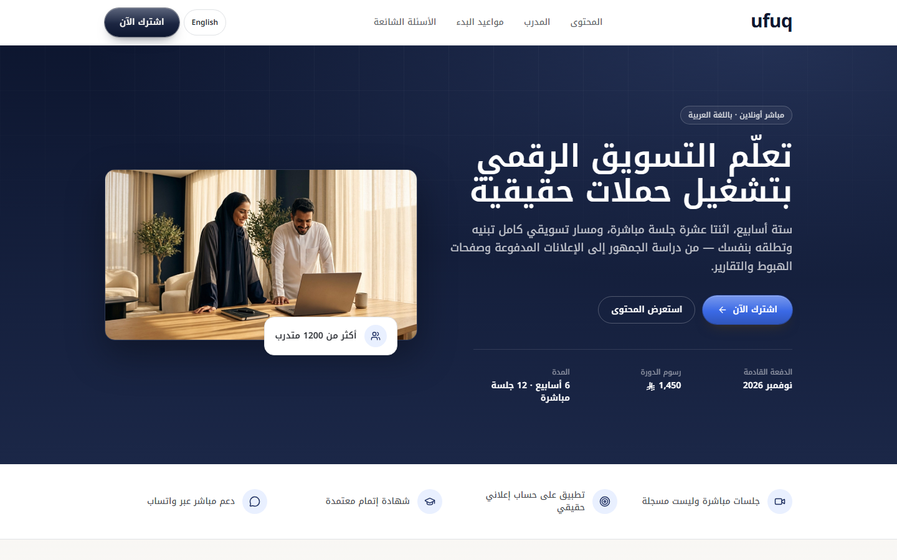
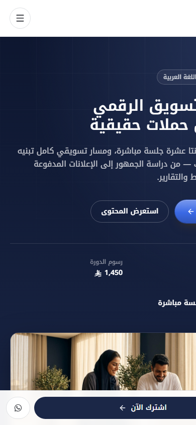

# Ufuq Academy — Course Registration Funnel

Arabic-first, bilingual (Arabic / English) registration funnel for a paid live course in Saudi Arabia, with bank-transfer payment and an operator dashboard.



<p align="center">
  
</p>

## User flow

```
Course page → Choose cohort → Participant details → Bank transfer + receipt upload → "Under review" confirmation
```

## Highlights

- **Working app, not a mockup.** Every screen is a real route with real state.
- **Bank transfer instead of a card gateway.** IBAN, SWIFT and account name each copy with one tap. Receipts upload by drag-and-drop (PNG / JPG / WEBP / PDF, up to 5 MB) with preview, replace and remove.
- **Live cohorts.** Four monthly cohorts with seat counts. Full cohorts can't be selected and offer a WhatsApp waitlist instead.
- **Operator dashboard.** Stats, search and filters, a receipt viewer with verify / reject, CSV export that opens Arabic correctly in Excel, and live editing of price, seats and cohort status.
- **WhatsApp integration.** Pre-filled `wa.me` messages in the active language for enquiries, waitlist and booking confirmation.
- **New Saudi Riyal symbol.** Rendered with a self-hosted symbol font.
- **Share previews that work.** A post-build script puts Open Graph tags first in `<head>` and cache-busts images, so WhatsApp link previews show on the first paste.
- **SEO.** Prerendered `/ar` and `/en` pages, `hreflang`, sitemap and JSON-LD (Course, CourseInstance, FAQ).
- **Mobile-first.** Sticky enroll bar, large touch targets, numeric keyboards on number fields.

## Pages

| Route | Content |
| --- | --- |
| `/` | Picks the language: last choice, then browser language, then Arabic |
| `/ar`, `/en` | Course page: outcomes, curriculum, instructor, cohorts, pricing, FAQ |
| `/ar/register`, `/en/register` | Four-step registration |
| `/ar/admin`, `/en/admin` | Operator dashboard (demo, `noindex`) |
| `/…/terms-and-refunds` | Terms and refund schedule |
| `/…/privacy-policy` | Privacy policy |

## Tech stack

| Area | Tools |
| --- | --- |
| Framework | React 19, TanStack Start, TanStack Router |
| Build | Vite 7, TypeScript |
| Styling | Tailwind CSS 4, shadcn/ui (Radix UI) |
| Forms | React Hook Form, Zod |
| Data | `localStorage` demo store, synced across tabs |
| Hosting | Prerendered static output on shared hosting |

## Architecture note

All data access goes through `src/lib/registration.ts`. Components read it through one hook, `useDemoStore()`. To connect a real backend, only that file changes.

## Project structure

```
src/
  routes/              pages listed above
  components/          site chrome, funnel parts
  lib/i18n/            ar.ts and en.ts dictionaries
  lib/course.ts        cohorts, pricing, instructor
  lib/company.ts       brand, contact and payout details
  lib/registration.ts  demo store, CSV, validation
  lib/whatsapp.ts      pre-filled message links
  lib/seo.ts           meta, hreflang and JSON-LD
scripts/               post-build site-URL tool
public/                fonts, images, share cards, sample receipt
```

## Running locally

Requires Node.js 20 or newer.

```bash
npm install
npm run dev
npm run build
npm run set-site-url -- https://your-domain.com
```


> Bank details, instructor, testimonials and registrations are fictional demo content.

## Author

Built by **Ameen Ali Ahmed** — [github.com/AlameenAlii](https://github.com/AlameenAlii)

## License

**All rights reserved.** This code is shown for portfolio viewing only. You may not copy, use, modify or distribute any part of it without my written permission. See [LICENSE](LICENSE).

Brand names belong to their owners. The Saudi Riyal symbol font is by Abdul Rehman Yaser (MIT). Open-source dependencies keep their own licenses.
